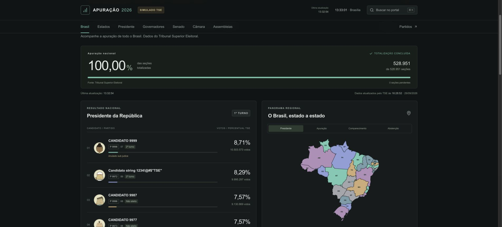

# Verificação realizada

Data: 4 de outubro de 2026.

- `npm test`: 60 testes passaram. Fixtures públicas do TSE cobrem produção e simulação, eleição, fase, turno, UF, cargo, município, percentuais, situações oficiais, Senado, resultados proporcionais e substituições. Cache testado com deduplicação de 100 consultas, concorrência e recuperação após falhas. O indicador de diferença cobre troca de liderança, empates múltiplos, corte do Senado, dados ausentes, p.p., recortes e histórico com sinal que atravessa o zero.
- `npm run build`: build de produção com Webpack e verificação TypeScript concluídos.
- `npm run test:routes`: páginas nacionais, estaduais, municipais, partidos e candidaturas; APIs, busca, códigos municipais, isolamento entre turnos e respostas 400/404. O comando exige servidor ativo e acesso ao TSE.
- Navegação no Chrome pelas seções nacionais, cargos estaduais, DF, municípios, perfil presidencial, partidos e segundo turno. Busca por Fortaleza e troca de cargo no recorte municipal verificadas.
- Layout revisado em desktop e viewport mobile de 390 × 844. Menu compacto, busca, horários de atualização e ausência de overflow horizontal na página verificados. Tabelas permitem rolagem interna.
- Corrigidos durante a revisão: dependência de gráficos, 404 antes do streaming, código IBGE vazio no exterior, identidade presidencial entre recortes, dados anteriores ao trocar consultas e siglas partidárias codificadas na URL.
- Indicador de vantagem conferido com resultados oficiais de produção para Presidente nacional, Presidente no Ceará e Governador no Ceará. Corte do Senado conferido na UF com as duas vagas informadas pelo TSE. Histórico real armazenado no Redis exibido com gráfico e tabela acessível. Layout do indicador verificado em mobile (390 × 844), sem overflow horizontal da página.

## Limites da validação

Não houve deploy público, provisionamento de Redis, teste de carga massivo ou auditoria automatizada completa de acessibilidade. Snapshots persistentes precisam das credenciais Redis. O ambiente de demonstração consulta o simulado público do TSE; não usa as fixtures de teste. Detalhes da integração e da documentação oficial disponível estão em [tse/SOURCES.md](tse/SOURCES.md).
